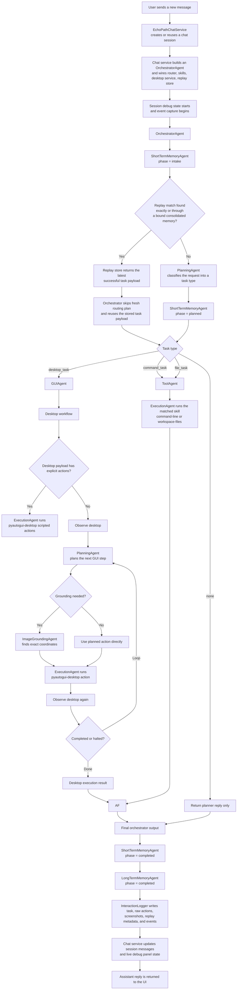
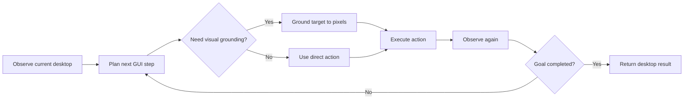
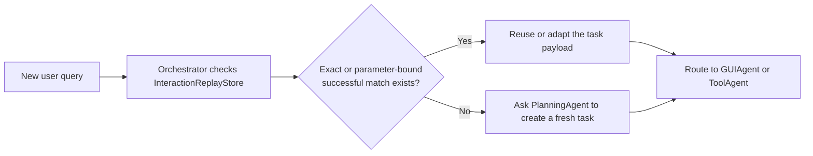

# Agent Flow For A New Task

This document shows how the current EchoPath agents and services work together when a new user task arrives.

## End-To-End Flow

## Agent Responsibilities

- `EchoPathChatService` is the product entry point. It owns sessions, debug state, and wiring of the orchestrator with skills, desktop control, and replay storage.
- `OrchestratorAgent` is the coordinator. It updates memory agents, checks replay first, asks for a routing decision when needed, then delegates execution by `task.type`.
- `PlanningAgent` handles two planning jobs:
  - route the incoming request into `desktop_task`, `command_task`, `file_task`, or `none`
  - plan the next desktop step during iterative GUI execution
- `GUIAgent` owns visible desktop work, including browser workflows in a normal browser window.
- `ToolAgent` owns command and file work.
- `ImageGroundingAgent` is only used when a desktop plan needs visual target localization before clicking or moving.
- `ExecutionAgent` is the common executor that actually invokes skills.
- `ShortTermMemoryAgent` and `LongTermMemoryAgent` are called around the orchestration lifecycle so memory can be updated before and after execution.

## Desktop Loop Detail

The desktop path is the most agentic path in the current system.

In practice this is:

- `observe`
- `plan`
- `ground` when needed
- `act`
- `observe again`
- repeat until completed, halted, or max iterations are reached

## Replay Path Detail

Replay does not remove orchestration. It changes where the orchestrator gets the routed task.

That means:

- planning still exists as part of the system design
- the orchestrator stays responsible for deciding whether a task is replayable
- when a replay hit exists, the orchestrator can skip planning from scratch and go directly into execution with the logged task
- consolidated memories are checked before raw action trajectories when both are available
- generalized consolidated memories can be rebound to current request inputs before replay; for example, the `arxiv_paper_download` memory accepts an arXiv paper URL, arXiv ID, or title and substitutes the current `search_url` and `pdf_url`
